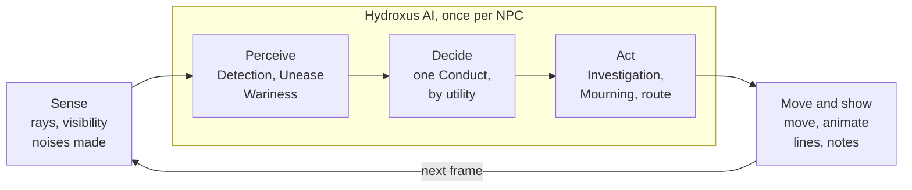
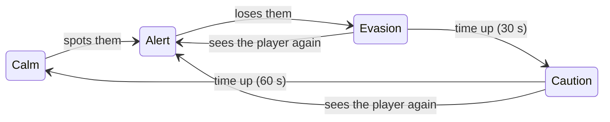

# Hydroxus AI Handbook

As of 5 November 2026. The living copy is the Claude Doc this file was exported from; this one is kept with the code.

## What Hydroxus AI is

Hydroxus AI is a Rust crate that decides what a game's NPCs see, hear and do; the game itself casts the rays, moves the nodes and plays the animations. It never touches a scene, depends only on `nalgebra` (the same one the Hydroxus engine re-exports), and has no engine types in its API, so it can be tested and benchmarked on its own.

It was built for Ruptura Systematis: stealth droids that hunt the player through Metal Gear's alert phases, a city's crowd with opinions and gossip, drones on patrol, and traffic. Repository: [d4140n-4h3-1/hydroxus-ai](https://github.com/d4140n-4h3-1/hydroxus-ai), branch `main`.

| Part | What it decides | Main modules |
| --- | --- | --- |
| `alert` | Which phase a hostile NPC is in (Alert, Evasion, Caution) and how long each lasts | `alert` |
| `perception` | What an NPC takes in: sight, gradual awareness, hearing, bolts flying by, what a witness can tell | `sight`, `detection`, `hearing`, `bolts`, `witness` |
| `tactics` | What it does about it: chase, search, investigate, shoot, take cover, fight as a team, patrol, and which of these to do | `utility`, `conduct`, `search`, `investigate`, `chase`, `pace`, `threat`, `fire`, `blind`, `cover`, `team`, `patrol` |
| `navigation` | How it gets about: the navmesh, routes, walking, ferries, trains, wandering a city, making way, driving, flying | `navmesh`, `walk`, `trip`, `ride`, `wander`, `steer`, `drive`, `traffic`, `flight` |
| `social` | NPCs among each other: groups, talk, reports, opinions, rumours, factions, ties, trouble, passing the player, the crowd | `group`, `talk`, `report`, `opinion`, `rumour`, `faction`, `chat`, `ties`, `trouble`, `passing`, `crowd` |
| `think` | What it learns and how it adapts: what has worked for it, the player's habits, where the player hides | `lesson`, `habit`, `haunt`, `experience` |

## Getting started

Add the crate from git, keep one `Tuning` for the whole game, and call into it once per NPC per frame.

```toml
[dependencies]
hydroxus-ai = { git = "https://github.com/d4140n-4h3-1/hydroxus-ai.git", branch = "main" }
# Optional: read tuning from a file
# hydroxus-ai = { git = "…", branch = "main", features = ["serde"] }
```

**One tuning for everything.** Every module's numbers live in its own `Tuning`, gathered in `hydroxus_ai::Tuning`. Ruptura Systematis keeps it as a constant and passes the part each call needs:

```rust
pub const AI: hydroxus_ai::Tuning = hydroxus_ai::Tuning::DEFAULT;

// e.g. awareness filling for one NPC this frame
npc.detection.step(&AI.detection, visible, eagerness, dt);
```

With the `serde` feature, a `Tuning` reads from JSON, and anything the file leaves out keeps its default: `{"patrol": {"engage": 15.0}, "alert": {"caution": 90.0}}`. A field name the tuning does not have is refused (`unknown field "fil", expected one of "fill", ...`), so a misspelling is an error rather than a default quietly kept.

**Check it before use.** `tuning.validate()` returns `Err(Invalid)` listing every problem, one per field, each with where it is, what it is and what it should be: every number finite; none negative except `opinion.wary`, `opinion.hostile` and the leftward offsets in `group.about_leader`; shares and chances from 0 to 1; angles from 0 to π; half-lives, fill times and other divisors above 0; counts that would leave a module idle at least 1; random ranges low to high; and settings that contradict each other (`hostile < wary < friendly`, `fire.engage ≤ fire.fire_range`, `rumour.forgotten ≤ rumour.tellable`, `ties.flee_nerve ≤ ties.avenge_nerve`, `threat.too_close ≤ threat.unease_range`, `lesson.sway < 1` so that what failed is never barred). Most of the crate clamps bad numbers rather than crash, so without this they show up as an NPC quietly behaving oddly.

```rust
let tuning: hydroxus_ai::Tuning = serde_json::from_str(&text)?;   // unknown names refused
if let Err(invalid) = tuning.validate() {
    eprintln!("{invalid}");   // e.g. "detection.fill is 0, but must be more than 0"
}
```

**The per-frame loop.** For each NPC the game does the same five things:

1. **Sense:** cast the rays the crate asks about (is anything between this NPC and the player?) and work out how visible the player is.
2. **Perceive:** step the NPC's state with what it saw and heard: `Detection::step`, `Detection::hear`, `Unease::step`.
3. **Decide:** read its situation into a `conduct::Reading` and let its role's reasoner choose a `Conduct`.
4. **Act:** run the chosen behaviour's state machine (`Investigation::step`, `Mourning::step`, a route from `NavMesh::route`) and get back what to do this step: face a heading, go to a point, kneel, stop.
5. **Move and show:** move the node along the route, play the animation, and turn the events that came back into lines, sounds and HUD notes.

`hydroxus_ai::prelude` imports what most games need at once: `Alert`, `NavMesh`, `WalkGrid`, `Sight`, `Heard`, `SearchMap`, `Threat` and the routing helpers.

## How it works

The crate is a library of small state machines and pure functions: the game feeds them what it measured, they return what to do, and nothing in between holds a reference to the scene.



The game measures and moves; everything between, for each NPC each frame, is the crate's.

- **The game owns the world.** Rays, physics, nodes, animations and sound are the game's. Where the crate needs to know whether something is in the way, it takes a closure (`in_sight: impl Fn(Vector3<f32>) -> bool`) or a value the game measured.
- **State lives with the NPC.** Each NPC carries plain structs: a `Detection`, a `Wariness`, an `Unease`, an `Investigation`, a `Mourning`, a `Passing`. The game steps them with `dt` and gets a result back: a `Change`, an `Uneasy`, a `Doing`.
- **Results are events, not lines.** The crate says what happened (`Change::Spotted`, `Uneasy::Noticed`, `patrol::Event`). The game picks the words, sounds and UI, so the crate never decides what a character says.
- **Every number is tuning.** Each module declares its constants once and gathers them with the `tuning!` macro into a `Tuning` struct with a `DEFAULT` const. Nothing reads a bare constant at runtime, so a game can override any of them, or load them from a file.
- **Choices are scored, not hard-coded.** `tactics::utility` turns inputs into scores through response curves; `tactics::conduct` uses it for every NPC on foot, and `tactics::patrol` for drones (see Tactics).
- **What is learned weighs; it never decides.** `think` keeps lessons, habits and haunts that fade with time, and leans the existing choices on them: a reasoner's scores, a search map's chances, a game's own inputs.
- **Hot paths are not generic.** Generic functions compile in the calling crate, and a game's own code is often unoptimised in development; the navmesh's routing ran ten times slower that way. Hot paths take `&dyn Fn` and are compiled, optimised, inside the crate.
- **Headings and units.** Directions along the ground are headings in radians, positive to the left of the world's +z. Distances are meters, times seconds.

Modules are tested on their own with plain data: 147 tests in `cargo test`, and `examples/ai_bench.rs` and `examples/navmesh_bench.rs` time the per-frame costs.

## Alert phases and wariness

A hostile NPC is always in one of Metal Gear's phases, and seeing the player in any of them puts it straight back on Alert.

- **Alert:** it sees the player and is after them.
- **Evasion:** it has lost them and searches, for 30 s by default (`EVASION`).
- **Caution:** it has given up searching and goes about as before, but watching, for 60 s (`CAUTION`); then it is calm again.



Wariness stretches the searching and watching times, up to three times as long.

`Alert::next(sees, left)` gives the phase that follows, and `Alert::lasts` how long the phase lasts. The game keeps the time left and steps it.

**Wariness draws the phases out.** An NPC's `Wariness` remembers what it has been through, and the worse it was, the longer it searches and stays wary, and the more keenly it looks for the player. Each incident moves it its weight of the way to fully wary, so incidents add up but never pass 1, and it fades by half every 180 s (`WARY_HALF_LIFE`).

| Incident | Weight |
| --- | --- |
| Found a body (`FoundBody`) | 0.8 |
| Was hit (`Hurt`) | 0.6 |
| A shot went by it (`ShotAt`) | 0.5 |
| Saw the player (`Spotted`) | 0.4 |
| Told of an alarm (`Alarm`) | 0.4 |
| Heard gunfire (`Gunfire`) | 0.3 |
| Heard enough to be sure (`Heard`) | 0.2 |
| Lost the player (`Lost`) | 0.2 |
| Noticed something (`Noticed`) | 0.1 |

Fully wary, the phases last three times as long (`LONGER` = 2, an extra 200%) and it becomes aware of the player twice as quickly (`KEENER` = 1). Call `Wariness::note(incident)` as things happen, `Wariness::lasts(alert)` for a phase's length, and `Wariness::keenness()` for the eagerness passed to detection.

## Perception

An NPC sees only in front of it, becomes aware of the player gradually, and hears along the floor rather than through walls; the game supplies the rays.

**Sight** (`perception::sight::Sight`). It sees clearly in a 55° cone each side of ahead, out to 30 m. Out of the corner of its eye, up to 100° each side, it sees only 35% as far, and behind it nothing at all, so it can be crept up on. Unless it is already hunting, a crouched player is seen from half as far and a crawling one from 30% as far; the dark cuts sight to 35%. `could_see` says whether the player is where it could see them; the game then casts a ray from its eyes for whatever is in the way. `visibility` says how visible they are, from 1 right in front down to 0.25 at the edge (half that out of the corner of the eye). Both take a `Seeing`: whether it is dark, and the fog if there is any (`Fog`, with the engine's own density, start, base height and height falloff, so an NPC sees about as far as the player does). A plain `bool`, dark or not, converts to one with no fog. In fog the NPC sees only as far as at least `faint` (25%) of someone shows through, and they are only as visible as how much of them does: in the game's foggy maps' fog someone 20 m off is about half as visible, and past about 45 m not seen at all. Fog takes nothing from hearing.

**Detection** (`perception::detection::Detection`), the sneaking meter. Awareness fills while the NPC can see the player, faster the more visible they are: a fully visible player is spotted in 1.2 s (`FILL`). It fills 3× faster for one already searching (`SEARCHING`) and 1.5× for a player with a weapon drawn (`ARMED`). Out of sight for 1 s it drains, 0.35 a second. Above 0.25 the NPC has noticed something (`Stage::Caution`); at 1 it has spotted them (`Stage::Danger`). `step` returns a `Change` (`Noticed`, `Spotted`, `Lost`) for the game to act on; `most_aware` gives the meter to show, and `bearing` the direction marks round the screen.

**Hearing** (`perception::hearing::Heard`). A noise is heard along the navmesh, not through walls: `Heard::at(mesh, at, loudness)` works out how far it carries, and `nearness(mesh, feet)` how loud it is where an NPC stands. Footfalls and landings feed the detection meter (`Detection::hear`, up to 0.6 of it for a noise right beside it); shots send searchers straight to where they were fired.

**Bolts** (`perception::bolts`). A bolt passing within 4 m in front of an NPC, or within 1 m of it from any side, is noticed. Several in a few seconds from someone it can't see make an armed NPC fire blind back that way (see Tactics).

**Witnesses** (`perception::witness`). An NPC that saw a shooting knows who did it if it saw the shooter within 15 m (`IDENTIFY_REACH`); further off, it only saw that it happened.

## Tactics

Every NPC chooses what to do by utility scoring, then runs that behaviour's own small state machine.

### Utility scoring (`tactics::utility`)

An `Action` has a weight and `Consideration`s; each reads one input through a response `Curve` (`Above`, `Below`, `Linear`, `Logistic`, `Constant`) into a score from 0 to 1. The action's score is its weight times all its considerations, with Dave Mark's compensation so that an action with more considerations is not marked down for having them. A `Reasoner` scores every action and picks the best, favouring the one already being done by its `inertia` so close scores don't flicker.

```rust
let mut r = Reasoner::new(vec![
    Action::new(Do::Flee, 1.0).when(In::Danger, Curve::Logistic { middle: 0.5, steepness: 12.0 }),
    Action::new(Do::Eat, 1.0).when(In::Hunger, Curve::Linear { from: 0.0, to: 1.0 })
                             .when(In::Danger, Curve::Below { at: 0.5 }),
    Action::new(Do::Idle, 0.2),
], 0.1);
let next = r.choose(&world, current); // world implements Situation<In>
```

Reasoners are plain data: built in code, changed by a designer, or read from JSON with `serde`. `scores` keeps the last scores, to show why an NPC did what it did.

### What an NPC on foot does (`tactics::conduct`)

The game first sees to what an NPC is held to and cannot choose: down, being carried, in a foot chase or caught, talking, or just turned hostile. Otherwise it fills a `Reading` and calls `Reasoners::choose(role, &reading, current)`, which returns one `Conduct`.

| Conduct | Open when | Sentry | Citizen | Gang | Fighter |
| --- | --- | --- | --- | --- | --- |
| Chase | after the player, seeing them | 1.0 | 1.0 | 0.97 | 0.96 |
| Fight | one of the other side to go after | 0.95 | 0.95 | 1.0 | 1.0 |
| ShootBack | shot at by someone unseen, on a side | 0.9 | 0.9 | 0.9 | 0.98 |
| Investigate | noticed something, going to look | 0.85 | 0.85 | 0.85 | 0.85 |
| Search | lost the player | 0.8 | 0.8 | 0.8 | 0.8 |
| Mourn | one of its own down (× nerve) | 0.8 | 0.8 | 0.8 | 0.8 |
| Report | has a sentry to tell | 0.75 | 0.97 | 0.75 | 0.75 |
| Shelter | a shootout near it | 0.7 | 0.96 | 0.7 | 0.7 |
| BackAway | a weapon drawn too near | 0.55 | 0.7 | 0.55 | 0.55 |
| Watch | a weapon drawn | 0.5 | 0.5 | 0.5 | 0.5 |
| Avoid | wary of the player passing | 0.45 | 0.45 | 0.45 | 0.45 |
| Regard | the player passing (× 1 − wariness) | 0.4 | 0.4 | 0.4 | 0.4 |
| Follow | walks with others, not leading | 0.2 | 0.2 | 0.2 | 0.2 |
| GoAbout | always | 0.05 | 0.05 | 0.05 | 0.05 |

Two considerations make it more than a priority list. Mourning scales with the NPC's nerve (`Linear` from −1 to 1), so with shooting about, one with little nerve takes cover and one with plenty stays by its own. Stopping to look at the player scales down with wariness, to nothing when fully wary. The game picks the role from the kind: a gang's, a citizen's (one that runs to tell security), security's, or a fighter's for anyone on a side.

### The behaviours

| Module | What it does | Key numbers |
| --- | --- | --- |
| `investigate` | Stops and faces what it noticed, walks over, looks about, then goes back to what it was doing; noticing again on the way redirects it | pauses 0.8 s, looks about 4 s, ±70°, gives up after 25 s |
| `search` | `SearchMap`: where the lost player could be, per navmesh polygon, spreading by walk distance; searchers share it and split the likeliest places; at each spot, `LookAbout::searching` sweeps the searcher's head 70° each way for 3 s (`search.look_about`, `look_sweep`) so its looks clear the map | |
| `chase`, `pace`, `join` | Cutting the player off rather than running after them, sprinting now and then and keeping breath, and others of its kind joining a chase they see | |
| `threat` | A weapon pointed at it (`Threat`): warning, last warning, provoked. A weapon only drawn (`Unease`): uneasy, backs off when near, settles once it's put away | aimed at within 20 m; uneasy after 0.6 s within 12 m, backs off within 4 m, settles after 3 s |
| `fire`, `blind` | When and how widely an armed NPC shoots; firing blind back where unseen shots came from | |
| `cover` | A bystander running to somewhere a shootout can't see it | |
| `team` | Fighting as a team: shared sightings, targets, cover, flanking, covering fire | |
| `patrol` | A drone's patrol, search and Alert, chosen by its own utility reasoner (`Engage`, `Search`, `Patrol`); its flight along routes through the air | |

## Navigation

All ground movement runs on a navmesh built once from a surveyed walk grid; the grid itself is only kept while the level is being set up.

**Building it.** The game surveys the level into a `WalkGrid`: cells of 0.5 m, their floor heights, several storeys, and where a stair step can be taken. `NavMesh::build(grid, origin, area)` merges walkable cells into rectangles, each on one storey, its floor level to within 5 cm (`FLAT`), of one area (a road, a doorway that can shut), and at most 16 cells a side (`MOST_CELLS`). Portals join rectangles along their shared edges. On Nexus that is 7,619 polygons in 1 MB, built in about 30 ms; a route takes about 0.3 ms against 1.2 ms on the grid.

**Changing it.** Doors, barriers and firewalls are cells marked shut with `set_walkable(cells, false)`; each frame `sync()` rebuilds only the polygons round the cells that changed, and a closed cell remembers its floor and area so it can reopen.

**Routing.** `route(feet, to, within, clearance, extra)` is an A\* over polygons, each meter across polygon `n` costing `1 + extra(n)`, then pulled taut through the portals (the funnel) and kept `clearance` meters from their ends. `costs_from` and `entries_from` give walk distances for hearing and searching; `Reach` is a bitset of polygons that can be got to from the player, worked out once per change rather than per search.

| Module | What it does |
| --- | --- |
| `walk` | Routes in meters, spots near a point, plans with costs to avoid |
| `trip` | Trips over floors and by ferry |
| `ride` | Taking a train: to the station, on at the doors, off at the stop (the game implements `ride::Train`) |
| `wander` | Going about one's business in a city: off the roads but at crossings (a meter of road costs 20×), off gangs' turf (3×), and away from any other spots it is given, such as trouble it knows of |
| `steer` | Making way in a corridor: veering right round anyone within 2.5 m ahead, stepping aside for someone coming straight at it |
| `drive` | At the controls: getting by others and stopping for them |
| `traffic` | A city's streets and riders: lanes 4 m wide, two each way (streets 16 m kerb to kerb), junctions with lights (12 s green, 3 s amber, 1.5 s all red) |
| `flight` | Free flight through the air, for drones, routes round what is in the way |

## Social

NPCs hold opinions of the player, pass news on to each other, belong to factions and groups, and react to what happens to their own; `Minds` holds all of it for every NPC, by the game's index.

**Opinion and rumour** (`opinion`, `rumour`). Each NPC's regard for the player runs from −1 to 1: over 0.3 it is friendly, under −0.2 wary, under −0.55 hostile. Seeing a deed done moves it the deed's weight: shooting −0.6, robbing −0.3, threatening −0.25, a weapon drawn −0.05, a bribe +0.15. Shootings, robberies and threats are talked about: each retelling is 0.7 as strong, hearsay moves regard 0.6 as much as seeing it, and rumours fade by half every 15 minutes. Regard eases back by half every 20 minutes and sways talk checks by up to 20 points. Call `Minds::saw_done(witnesses, deed, at, victim_faction)`.

**Factions** (`faction`). A faction's standing with the player outlasts its members, so a crowd NPC turning up afresh starts at 0.8 of it. A deed counts by who it was done to: each faction's `relation` to the victim's (1 as to its own, 0 indifferent, −1 good news) scales its effect, and harm to no one in particular uses its relation to `nobody`. Standing moves at half a witness's rate and halves every hour. In Ruptura Systematis the gang is glad when security is shot (relation −0.6) and doesn't mind a robbery (0).

**Talk** (`talk`, `chat`). Two NPCs who meet, or a group, talk about the strongest news one has that another doesn't, then trouble, then how they feel about the player if strongly (|regard| ≥ 0.3), else small talk. `chat::topic` picks, `chat::heard` makes it sink in.

| Module | What it does |
| --- | --- |
| `group` | Pairs and groups: who leads, where each keeps about the leader, who speaks for the group, who leads once the leader is gone |
| `report` | A witness making for the nearest sentry within 150 m, telling it within 2.5 m, hiding for up to 30 s with none about; an alarm heard within 40 m |
| `ties` | One of a pair or group shot down before the rest: each `grieve`s by its nerve. With the nerve (≥ 0.5), the means and knowing who, it goes after them; under 0.3 it runs; otherwise it kneels by its own for 8 s (`Mourning`). Those who saw who did it hold a further −0.3 grudge |
| `trouble` | Bodies found, alarms and gunfire, told on like rumours but forgotten in about 5 minutes; the same kind within 20 m is the same trouble; NPCs keep up to 30 m away from what they know of |
| `passing` | The player passing within 5 m: friendly NPCs greet or tip them off, neutral ones sometimes nod (30%), wary ones keep away, hostile ones glare; each at most every 2 minutes, and only one NPC every 6 s |
| `crowd` | A city's crowd: only so many NPCs, those far off and out of sight turning up again nearer the player |

## Learning and adapting (`think`)

What an NPC learns, kept by the game per NPC, per squad or per faction, and weighing what the rest of the crate already does. Everything learned fades with time, so a player who changes their ways is met afresh; can be told to another at half strength (`tell`), so a squad comes to think alike; and, with `serde`, saved between sessions.

**What has worked** (`think::lesson`). `Lessons<A>` keeps what an NPC makes of each action, from −1 (never works) to 1 (always does). The game says how each turned out with `learn(tuning, action, outcome)`: a search that found the player, 1; a chase they escaped, −1. Each outcome moves it a quarter of the way (`rate`), so a run of them counts and one fluke does not. `Lessons::choose` runs a `Reasoner` with each score times `1 + sway × worth` (0.5 to 1.5 by default), through `Reasoner::choose_by`. A bias only weighs what is open: what the considerations shut stays shut, and what never worked is less likely, never barred. It fades halfway in 10 minutes.

```rust
let conduct = lessons.choose(&tuning.lesson, reasoners.of(role), &reading, current).unwrap_or(Conduct::GoAbout);
// …later, when it is known how it went:
lessons.learn(&tuning.lesson, Conduct::Search, if found { 1.0 } else { -0.5 });
```

Once what it makes of an action passes `sure` (0.5) either way, it has come to a `View` of it: `Works` or `Fails`. `learn`, `tell` and `step` give back a `Verdict` whenever that changes, for the game to say out loud ("Chasing them is no use, search the alleys") or to pass to the squad. It gives a view up only once it falls back under half of `sure`, so it does not flip back and forth.

An outcome is seldom down to what the NPC is doing that moment: a search finds the player because the chase before it kept them in sight. A `Trail<A>` keeps the last 8 things it did. `trail.turned_out(tuning, &mut lessons, outcome, down_to)` credits each one the outcome is `down_to`: what it is doing in full, and what it gave up `credit` (10 s) ago at half. The game only has to say how things went, not when it chose what.

**All of it at once** (`think::experience`). `Experience<T>` is one NPC's lessons, trail, habits and haunts together. `choose(…)` picks its conduct, weighed by what it learned, and notes it on the trail. `held()` marks it as held to something it did not choose. `report(tuning, mesh, outcome)` takes an `Outcome`: the `Venture` it was on (Investigation, Pursuit, Defence, Cooperation, Search), how it went (`succeeded`, `failed`, `came_to_nothing` = −0.5, `partly(share)`), and optionally where the player was and what they did. That goes to the conducts the venture `covers` on the trail, to its haunts (found, counting 3×, or seen), and to its habits. With `sway` at 0 it chooses exactly as the reasoner alone would.

```rust
let conduct = experience.choose(&tuning, &mut reasoners, role, &reading, current);
// …a search turned up nothing:
for verdict in experience.report(&tuning, Some(&mesh), Outcome::came_to_nothing(Venture::Search)) { /* say it */ }
```

**The player's habits** (`think::habit`). `Habits<T>` counts what the player does, by the game's own enum (the way they come in, how they deal with a guard): `saw(what)` each time. `share(what)` is how much of what they do it is, `sureness()` how far to go by it (a half after 4 sightings), and `expect(what)`, both in one from 0 to 1, is made to be a utility input: a guard that has seen the player come over the roofs again and again watches the roofs. It fades halfway in 15 minutes.

**Where the player turns up** (`think::haunt`). `Haunts` keeps where the player was seen (`seen_at`) and found hiding (`found_at`, counting 3×), by navmesh cell, so haunts survive doors opening and shutting. Report the moments that matter, such as spotted, lost or found, not every frame. Once the player is lost, `haunts.lean(tuning, mesh, &mut map)` after `SearchMap::lose` weighs each polygon by the haunts within 4 m of it, up to twice as likely. It only reweighs where they could be, never adds chance where they could not have got to. `likeliest(mesh)` gives a patrol somewhere to go by. At most 64 haunts are kept, and each fades halfway in 30 minutes.

## Integrating with a game

Ruptura Systematis is the reference integration: `src/inhabitants.rs` holds every droid's AI state and steps it, and `src/game.rs` turns what comes back into lines, sounds and notes.

- **One state struct per NPC.** Each droid (`Inhabitant`) carries its `Detection`, `Wariness`, `Unease`, `Investigation`, `Mourning`, `Passing`, its alert phase, its route and its last `Conduct`. All of the droids share one `Minds`, one `Groups` and one set of `Reasoners`.
- **The game supplies the world through closures.** `could_see` and a ray cast for line of sight; the navmesh for hearing and routes; `is_sentry(character)` for who answers an alarm or a radio call.
- **Data drives the kinds.** Each kind of droid is a character in the game's JSON: its lines, its faction, its role, how many walk in pairs or groups, its turf, and what share wear a radio. The crate only sees numbers and enums.
- **Events become content.** A `Change::Spotted` becomes the "spotted" bark and red eyes; a radio call that goes through calls `radio_call` on every sentry within 300 m; a `Grief::Avenge` turns a gang member hostile.

**Saving.** With `serde`, an NPC's live state can be saved and loaded as well as what it learned: `Detection`, `Wariness`, `Alert`, `Investigation`, `LookAbout`, `SearchMap`, `Witness`, `Unease`, `Mourning`, `BlindFire`, `Experience`. A guard saved mid-search carries on exactly as if it never was (`tests/persistence.rs`).

**Testing.** Each module is tested with plain data (`cargo test`: 159 unit tests), and `tests/scenarios.rs` runs them together: a test-only guard on a small corridor-and-room level, through the per-frame loop above, hearing, investigating, spotting, chasing, losing, searching, being told and going back to routine, at frame rates from 30 to 144 Hz, steady, uneven and hitching. It is also a worked example of wiring the modules up. Game-side behaviour is tried on small maps. In Ruptura Systematis, the Test section's Demo Town is peopled as Urbs is and loads in about a second. `MAZE_KNOCKDOWN=<seconds>` shoots the droid nearest the player to start witnesses, chases and radio calls, and `MAZE_DEBUG=1` logs what the AI did. `cargo run --release --example ai_bench` times a city's traffic, 50 drones and 2,000 flight routes: on the order of 0.05 ms, 0.003 ms and 2 ms.

**Developing against a local checkout.** Add a temporary path patch to the game's `.cargo/config.toml`:

```toml
[patch."https://github.com/d4140n-4h3-1/hydroxus-ai.git"]
hydroxus-ai = { path = "../hydroxus-ai" }
```

Remove it before committing the game, push the crate first, then run `cargo check` so `Cargo.lock` pins the new commit from GitHub.

## Quick reference

The types a game touches most, and what to call on them each frame.

| Type | Module | Call | Returns |
| --- | --- | --- | --- |
| `Tuning` | crate root | `Tuning::DEFAULT`, or read from JSON | every module's numbers |
| `Alert` | `alert` | `next(sees, left)`, `lasts(tuning)` | the next phase, how long it lasts |
| `Wariness` | `alert` | `note(incident)`, `step(dt)`, `lasts(alert)`, `keenness()` | how long phases last, how keen it is |
| `Sight` | `perception::sight` | `could_see(…)`, `visibility(…)` | whether it could see them, how visible they are |
| `Detection` | `perception::detection` | `step(tuning, visible, eagerness, dt)`, `hear(…)` | `Option<Change>`: Noticed, Spotted, Lost |
| `Heard` | `perception::hearing` | `at(mesh, at, loudness)`, `nearness(mesh, feet)` | how loud a noise is where an NPC stands |
| `Reasoners` | `tactics::conduct` | `choose(role, &reading, current)` | the `Conduct` to do |
| `Reasoner<A, I>` | `tactics::utility` | `choose(&situation, current)` | the best action, with `scores` kept |
| `Investigation` | `tactics::investigate` | `step(tuning, feet, heading, dt)` | `Doing`: Face, GoTo, LookAround, Done |
| `Unease` | `tactics::threat` | `step(tuning, sees, distance, dt)` | `Option<Uneasy>`: Noticed, Afraid, Wary, Settled |
| `NavMesh` | `navigation::navmesh` | `build`, `set_walkable`, `sync`, `route` | a route of points, last first |
| `Minds` | `social::rumour` | `saw_done`, `tell`, `came_across`, `step(dt)` | regard, rumours, faction changes |
| `Mourning` | `social::ties` | `step(tuning, feet, dt)` | `Doing`: GoTo, Kneel, Done |
| `Lessons<A>` | `think::lesson` | `choose(…)`, `learn(action, outcome)`, `tell`, `step(dt)` | the action to do, weighed by what worked; `Verdict`s when it changes its mind |
| `Experience<T>` | `think::experience` | `choose(…)`, `held`, `report(…, outcome)`, `tell`, `step(dt)` | conduct weighed by its own history; `Verdict`s |
| `Habits<T>` | `think::habit` | `saw(what)`, `expect(what)`, `likeliest()`, `step(dt)` | how much the player is expected to do it |
| `Haunts` | `think::haunt` | `seen_at`, `found_at`, `lean(…, &mut map)`, `likeliest`, `step(dt)` | a search leaned on where they hide |
| `Passing` | `social::passing` | `gesture(…)`, `ready`, `did`, `step` | Greet, Tip, Nod, Avoid or Glare |

Every default number named in this handbook is that module's `Tuning::DEFAULT`; change it in your own `Tuning` rather than in the crate.
